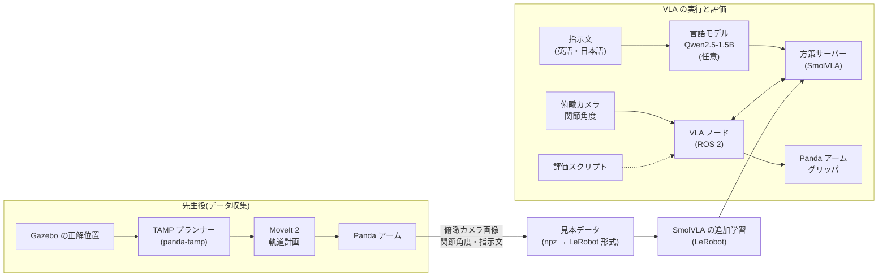

# trash-sort-vla:言葉で頼めるゴミ分別ロボット

ROS 2 Jazzy + Gazebo Harmonic 上の Franka Panda アームに、**「缶を青いゴミ箱に入れて」のような言葉の指示でゴミを分別させる** VLA(Vision-Language-Action)モデルを学習・評価・改善したプロジェクトです。

- 従来のタスク・動作計画(TAMP + MoveIt 2)を「先生役」にして見本を自動収集し、**SmolVLA**(LeRobot)を追加学習しました
- 学習したVLAを Gazebo 上で動かす **ROS 2 ノード**と、成功率を自動で測る**評価の仕組み**を作りました
- 評価で見つかった2つの弱点(**言い換えへの弱さ**、**物を位置で覚える近道学習**)に対して、それぞれ改善を試しました

> 本リポジトリは [panda-tamp](#元のリポジトリとの関係)(MIT License)をベースに開発しています。

**デモ動画**:(動画のURLを記入)

---

## 目次

1. [タスク](#タスク)
2. [システム構成](#システム構成)
3. [結果のまとめ](#結果のまとめ)
4. [元のリポジトリとの関係](#元のリポジトリとの関係)
5. [動作環境](#動作環境)
6. [セットアップ](#セットアップ)
7. [実行手順](#実行手順)
8. [ファイル構成](#ファイル構成)
9. [限界と今後の課題](#限界と今後の課題)
10. [ライセンスとクレジット](#ライセンスとクレジット)

---

## タスク

机の上の3種類のゴミ(缶・ペットボトル・紙コップ)を、色分けされた3つのゴミ箱(青・緑・オレンジ)に、**言葉の指示どおりに**入れます。

9通りの組み合わせのうち、**3通りを評価専用**にして学習データから除外しました。これにより、VLAが言葉を組み合わせて理解しているのか、見た組み合わせを丸暗記しているだけなのかを測ります。

|  | 青 | 緑 | オレンジ |
|---|---|---|---|
| 缶 | 学習 | **評価専用** | 学習 |
| ペットボトル | **評価専用** | 学習 | 学習 |
| 紙コップ | 学習 | 学習 | **評価専用** |

---

## システム構成



| 部品 | 内容 |
|---|---|
| 先生役 | Gazebo から物体の正確な位置を受け取り、TAMP で作業手順を決め、MoveIt 2 で衝突のない軌道を計算して実行する |
| データ収集 | 先生役に分別を繰り返させ、俯瞰カメラ画像(320×320、10Hz)・関節角度・指示文を記録。成功の判定は Gazebo 上の正解位置で行う |
| VLA | SmolVLA(`lerobot/smolvla_base`)を追加学習。入力は俯瞰カメラ画像・関節角度8個・指示文、出力は関節7個の目標角度とグリッパの開閉 |
| 方策サーバー | LeRobot の環境で SmolVLA と(任意で)言語モデルを動かす。ROS 2 とは別プロセスにして、ライブラリの衝突を避けた |
| VLA ノード | ROS 2 の環境で動き、カメラと関節角度をサーバーに送り、返ってきた行動をアームとグリッパのコントローラに送る |
| 言語モデル | どんな言い方の指示でも、学習時と同じ標準の言い方に変換する(物とゴミ箱の色を選択肢から選ばせ、テンプレートに当てはめる) |

掴む動作は、先生役と同じく Gazebo の DetachableJoint で補助しています(グリッパが閉じたとき、手の真下にある物体を固定)。

---

## 結果のまとめ

### 学習したモデル

すべて同じ設定(20,000ステップ、バッチ32、RTX 3060 で約4.5時間)で学習し、**学習データだけ**を変えています。

| モデル | 学習データ |
|---|---|
| **v1**(ベースライン) | いつもの配置の見本162件、標準の言い方のみ |
| **v2** | v1 と同じ見本。指示文の7割を言い換えに差し替え |
| **v3** | v2 + ゴミの配置を入れ替えた見本(90件を収集) |
| **v3b** | v3 と同じ見本。配置を入れ替えた見本を3回ずつ使い、その割合を約6割に増やした |
| **v1 + 言語モデル** | v1 の前に、指示文を標準の言い方に直す言語モデル(Qwen2.5-1.5B-Instruct)を置いたもの |

### 評価指標

| 指標 | 意味 |
|---|---|
| 成功 | 指示されたゴミを、指示されたゴミ箱に置いた(手を放した) |
| 運べた | 指示されたゴミ箱の上まで運んだ(放したかは問わない)。**指示を理解できたか**を表す |

### 1. いつもの配置・標準の言い方

| モデル | 運べた(学習した6通り) | 運べた(評価専用の3通り) | 成功(学習した6通り) | 成功(評価専用の3通り) |
|---|---|---|---|---|
| v1 | **26/30(87%)** | 9/15(60%) | 13/30 | 4/15 |
| v2 | 14/30(47%) | 11/15(73%) | 8/30 | 2/15 |
| v3 | 17/30(57%) | 7/15(47%) | 10/30 | 1/15 |
| v3b | 16/30(53%) | 5/15(33%) | 11/30 | 4/15 |

v1 は、学習で見せていない組み合わせ(例:缶→緑)でも 60% を指示どおりのゴミ箱まで運べました。**色の言葉と物の言葉を組み合わせて理解している**ことを示しています。

### 2. 初めての言い回し(改善1)

評価専用の言い回し(例:`could you sort the beverage can into the blue bucket?`)で指示しました。学習用の言い換えとは、文の形・物の呼び方・ゴミ箱の呼び方がすべて異なります。

| モデル | 運べた | 成功 |
|---|---|---|
| v1 | 0/27(0%) | 0/27 |
| v2(言い換えで学習) | 13/27(48%) | 2/27 |
| v3 | 12/27(44%) | 6/27 |
| **v1 + 言語モデル** | **19/27(70%)** | **7/27** |

- 言い換えで学習した v2 は 0% → 48% に改善したが、**標準の言い方での性能が下がる副作用**があった(上の表1:87% → 47%)
- 言語モデルで前処理する方法は、**VLA を変えないので標準の性能をそのまま保ち**、初めての言い回しでも 70% まで回復した
- 言語モデル単体の変換精度は、評価用の言い回し 144 通りで **144/144**、日本語の指示 8 通りでも **8/8**(日本語の「青」を緑と解釈する問題を、プロンプトの対応表で修正)

### 3. 配置の入れ替え(改善2)

3つのゴミの置き場所を入れ替えて評価しました。

| モデル | 配置を入れ替えた見本の割合 | **正しいゴミを掴んだ** | いつもの場所の別の物を掴んだ | 運べた |
|---|---|---|---|---|
| v1 | 0% | 0/27 | 25 | 0/27 |
| v2 | 0% | 0/27 | 21 | 0/27 |
| v3 | 約2割 | 4/27 | 17 | 2/27 |
| **v3b** | **約6割** | **10/27** | 10 | 3/27 |

- v1 は物を**見た目ではなく位置で覚えていた**(「ペットボトル」=「中央の場所」)。配置を入れ替えると、ほぼ毎回いつもの場所にある別の物を掴んだ
- 配置を入れ替えた見本の割合を増やすほど、正しいゴミを掴む回数が増えた。見分けやすい順(白い紙コップ → 水色のペットボトル → 銀色の缶)に改善した
- ただし、**いつもの配置で違うゴミを掴む副作用**が増えた(45回中:v1 ほぼ0 → v3 3回 → v3b 17回)。位置の手がかりを捨てても、見た目で見分ける力が十分に育っていないことを示している

### 分かったこと

- VLA は、学習データの中で**区別する必要がなかったこと(物の見た目)は学ばず、近道(位置)を覚える**
- 学習の `loss` が最も低かった v2 が、実際の性能では最も悪いなど、**`loss` だけではモデルの良し悪しは判断できず**、シミュレーションで動かす評価が不可欠だった
- 言葉の多様さへの対応は、VLA に学ばせるより、**言語モデルで前処理する方が効果的**だった(今回の範囲では)

> 評価の注意:各条件は 27〜45 回の試行で、数値には誤差があります。各モデルは1回ずつしか学習していません。v1 の「配置の入れ替え」と「初めての言い回し」は、別のモデルの学習と同時に評価しました(シミュレーションの平均速度は実時間の 1.02 倍で、影響は小さいことを確認済み)。

---

## 元のリポジトリとの関係

本リポジトリは **panda-tamp**(Franka Panda 向けの閉ループ TAMP、MIT License)を土台にしています。元の作者の説明は [`docs/README_panda_tamp.md`](docs/README_panda_tamp.md) に残しています。

元のリポジトリ:(元リポジトリのURLを記入)

### 元のリポジトリの部分(そのまま使用)

- TAMP のプランナー(`tamp/`、`pddl/`)
- MoveIt 2 との連携と、Panda アームの基本設定(`ros2_ws/src/` の既存パッケージ)

### 追加・変更したファイル

| 区分 | ファイル | 内容 |
|---|---|---|
| シーン | `ros2_ws/src/pytamp_moveit_bridge/worlds/trash_sort.sdf` | ゴミ分別のワールド(物理設定、俯瞰カメラ、撮影用カメラ) |
| | `ros2_ws/src/pytamp_moveit_bridge/description/panda_gazebo_trash.urdf.xacro` | ゴミを掴むための DetachableJoint |
| | `ros2_ws/src/pytamp_moveit_bridge/config/scene_trash.yaml` | 先生役から見たゴミ箱の位置 |
| | `benchmarks/scene_trash.py` | 先生役の物体の定義 |
| | `ros2_ws/src/pytamp_moveit_bridge/launch/trash_sort.launch.py` | 起動ファイル(カメラの中継を含む) |
| | `ros2_ws/src/pytamp_moveit_bridge/scripts/moveit_executor.py` | 実行速度を環境変数 `TAMP_VEL_SCALE` で変えられるよう変更 |
| 先生役の調査 | `tools/check_grasp.py` | Gazebo なしで計画の実行可能性を調べる |
| | `tools/run_goals.py` | Gazebo 上での先生役の成功率の測定 |
| データ収集 | `tools/collect_demos.py` | 見本の自動収集(位置のランダム化、配置の入れ替え、正解位置による成功判定) |
| | `tools/collect_loop.sh` | 失敗が続いたときに自動で起動し直す監督スクリプト |
| | `tools/inspect_demo.py` | 収集したデータの確認 |
| 学習データ | `tools/convert_to_lerobot.py` | LeRobot 形式への変換(急な関節の動きの除外、言い換えの付与、データの繰り返し) |
| | `tools/phrasing.py` | 指示文の標準形・学習用の言い換え・評価用の言い回し |
| VLA の実行 | `tools/policy_server.py` | SmolVLA と言語モデルを動かす方策サーバー |
| | `tools/vla_node.py` | VLA で Gazebo のアームを動かす ROS 2 ノード |
| 言語モデル | `tools/normalizer.py` | 指示文を標準の言い方に変換(Qwen2.5-1.5B-Instruct) |
| | `tools/test_normalizer.py` | 変換の正解率の測定 |
| 評価 | `tools/eval_vla.py` | 成功率の自動評価(配置の入れ替え、言い回しの変更、録画) |
| 動画 | `tools/make_video.py`、`tools/compose_video.py` | 評価の録画から動画を作成(16:9 のレイアウト合成) |
| その他 | `pyproject.toml` | `mcp` ライブラリ 2.x との互換性のため、`mcp<2` に固定(元の作者のテストを動かすため) |

---

## 動作環境

| 項目 | 内容 |
|---|---|
| OS | Windows 11 + WSL2(Ubuntu 24.04) |
| GPU | NVIDIA RTX 3060(12GB) |
| ROS | ROS 2 Jazzy、Gazebo Harmonic、MoveIt 2 |
| 学習 | LeRobot 0.6.1、PyTorch 2.11(CUDA) |
| 言語モデル | Qwen2.5-1.5B-Instruct(Hugging Face) |

WSL2 で Gazebo の描画に GPU を使うため、`~/.bashrc` に次を設定しています。

```bash
export GALLIUM_DRIVER=d3d12
export MESA_D3D12_DEFAULT_ADAPTER_NAME=NVIDIA
```

---

## セットアップ

### 1. ROS 2 側

ROS 2 Jazzy、Gazebo Harmonic、MoveIt 2 をインストールした後、ワークスペースをビルドします。panda-tamp の依存関係は、元の作者の手順([`docs/README_panda_tamp.md`](docs/README_panda_tamp.md))に従ってください。

```bash
cd ~/projects/panda-tamp
source scripts/ros_env.sh
cd ros2_ws && colcon build --symlink-install && cd ..
```

### 2. LeRobot 側(学習と VLA の実行)

ROS 2 とは別の Python 仮想環境を使います。**同じターミナルで2つの環境を混ぜないでください**。

```bash
python3 -m venv ~/lerobot-env
source ~/lerobot-env/bin/activate && unset PYTHONPATH
pip install "lerobot[smolvla]==0.6.1"
```

### 3. 動画の作成(任意)

```bash
sudo apt install -y fonts-noto-cjk
~/projects/panda-tamp/.venv/bin/pip install imageio imageio-ffmpeg
```

### ターミナルの使い分け

| 用途 | 最初に実行するコマンド |
|---|---|
| ROS 2(Gazebo、VLA ノード、評価) | `source scripts/ros_env.sh && source ros2_ws/install/setup.bash` |
| LeRobot(変換、学習、方策サーバー) | `source ~/lerobot-env/bin/activate && unset PYTHONPATH` |

---

## 実行手順

### 1. シーンを動かす(先生役)

```bash
ros2 launch pytamp_moveit_bridge trash_sort.launch.py gui:=true item:=can bin:=bin_blue
```

`PLAN COMPLETE` まで進めば、先生役が缶を青いゴミ箱に運んでいます。

### 2. 見本を集める

```bash
# いつもの配置(組み合わせごとに30件)
tools/collect_loop.sh 30 ~/projects/panda-tamp/data/raw 2>&1 | tee -a data/raw/loop.log

# 配置を入れ替えた見本(v3、v3b 用。組み合わせごとに15件)
tools/collect_loop.sh 15 ~/projects/panda-tamp/data/raw_perm --layout-mode permute 2>&1 \
  | tee -a data/raw_perm/loop.log
```

### 3. LeRobot 形式に変換する

```bash
R=$HOME/projects/panda-tamp/data/lerobot
# v1
python tools/convert_to_lerobot.py --max-jump 2.0 --root $R/trash_sort --repo-id local/trash_sort
# v2(言い換え)
python tools/convert_to_lerobot.py --max-jump 2.0 --phrasing train \
  --root $R/trash_sort_para --repo-id local/trash_sort_para
# v3(配置の入れ替えを追加)
python tools/convert_to_lerobot.py --max-jump 2.0 --phrasing train --raw data/raw data/raw_perm \
  --root $R/trash_sort_v3 --repo-id local/trash_sort_v3
# v3b(配置の入れ替えを3回ずつ使う)
python tools/convert_to_lerobot.py --max-jump 2.0 --phrasing train --raw data/raw data/raw_perm --repeat 1 3 \
  --root $R/trash_sort_v3b --repo-id local/trash_sort_v3b
```

### 4. 学習する

```bash
lerobot-train \
  --policy.path=lerobot/smolvla_base \
  --dataset.repo_id=local/trash_sort \
  --dataset.root=$HOME/projects/panda-tamp/data/lerobot/trash_sort \
  --rename_map='{"observation.images.overhead": "observation.images.camera1"}' \
  --batch_size=32 --steps=20000 --log_freq=100 --save_freq=5000 \
  --output_dir=outputs/train/smolvla_trash_v1 --job_name=smolvla_trash_v1 \
  --policy.device=cuda --policy.push_to_hub=false --wandb.enable=false
```

v2 以降は、`--dataset.repo_id`、`--dataset.root`、`--output_dir`、`--job_name` だけを変えます。

### 5. VLA を動かして評価する

4つのターミナルを使います。

```bash
# ターミナル1:Gazebo(ROS 2)
ros2 launch pytamp_moveit_bridge trash_sort.launch.py gui:=false item:=none

# ターミナル2:方策サーバー(LeRobot)。--normalizer は言語モデルを使う場合のみ
python tools/policy_server.py \
  --ckpt outputs/train/smolvla_trash_v1/checkpoints/last/pretrained_model \
  --normalizer Qwen/Qwen2.5-1.5B-Instruct

# ターミナル3:VLA ノード(ROS 2)。--normalize で言語モデルによる変換を有効にする
python3 tools/vla_node.py

# ターミナル4:評価(ROS 2)
python3 tools/eval_vla.py --trials 5                       # いつもの配置・標準の言い方
python3 tools/eval_vla.py --trials 3 --layout swap         # 配置の入れ替え
python3 tools/eval_vla.py --trials 3 --phrasing unseen     # 初めての言い回し
```

1つの指示だけを試す場合は、次のように送ります。

```bash
ros2 topic pub --once /vla/task std_msgs/msg/String "data: 'put the can in the blue bin'"
ros2 topic pub --once /vla/task std_msgs/msg/String "data: '缶を青い箱に入れて'"   # --normalize 時
ros2 topic pub --once /vla/task std_msgs/msg/String "data: 'stop'"
```

### 6. 言語モデルの変換精度を測る(Gazebo 不要)

```bash
python tools/test_normalizer.py
```

### 7. 動画を作る

```bash
# 評価の様子を録画(俯瞰カメラと撮影用カメラ)
python3 tools/eval_vla.py --only can:bin_blue --trials 2 --tag v1 --record outputs/rec/s2

# 16:9 のレイアウトに合成
.venv/bin/python tools/compose_video.py single  out.mp4 outputs/rec/s2/<file>.npz
.venv/bin/python tools/compose_video.py compare out.mp4 <改善前>.npz <改善後>.npz
```

---

## ファイル構成

```
trash-sort-vla/
├── benchmarks/scene_trash.py          # 先生役の物体の定義
├── ros2_ws/src/pytamp_moveit_bridge/
│   ├── worlds/trash_sort.sdf          # ワールド
│   ├── launch/trash_sort.launch.py    # 起動ファイル
│   ├── config/scene_trash.yaml        # ゴミ箱の位置
│   └── description/panda_gazebo_trash.urdf.xacro
├── tools/                             # データ収集・変換・VLA・評価・動画のスクリプト
├── tamp/、pddl/、...                  # 元の panda-tamp
└── docs/README_panda_tamp.md          # 元の作者の README
```

データ(`data/`)、学習済みモデルと評価結果(`outputs/`)は容量が大きいため、リポジトリには含めていません。上の手順で作り直せます。

---

## 限界と今後の課題

| 課題 | 内容 | 改善の方向 |
|---|---|---|
| 放す判断 | 指示どおりのゴミ箱まで運べても、手を放さない場合が多い | 放す場面の見本を増やす、グリッパの判断の後処理を工夫する |
| 見た目による識別 | 俯瞰カメラの画像(320×320)ではゴミが10〜15ピクセルと小さく、白い紙コップと銀色の缶の区別が難しい | 手首カメラの追加、解像度の向上、見た目の違いが大きい物体 |
| 掴む動作 | Gazebo の DetachableJoint で固定を補助している | 物理的な把持の再現、実機での検証 |
| 先生役 | 物体の正確な位置を使って動いており、成功率は5割弱 | 先生役自体の改善で、データの量と質を上げる |
| 統計 | 各条件は 27〜45 回、各モデルの学習は1回のみ | 試行回数と学習の繰り返しを増やす |

---

## ライセンスとクレジット

本リポジトリは [MIT License](LICENSE) です。元の panda-tamp の著作権表示とライセンスを含みます。

使用した主なオープンソース:

- **panda-tamp**(ベースのリポジトリ、MIT License)
- ROS 2 Jazzy / Gazebo Harmonic / MoveIt 2
- LeRobot / SmolVLA(`lerobot/smolvla_base`)
- Qwen2.5-1.5B-Instruct

関連研究:

- LIBERO-Para(arXiv:2603.28301):VLA の言い換えへの頑健性の評価。本プロジェクトの「初めての言い回し」による評価の参考にした