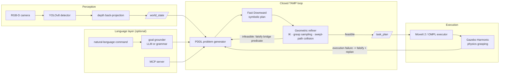
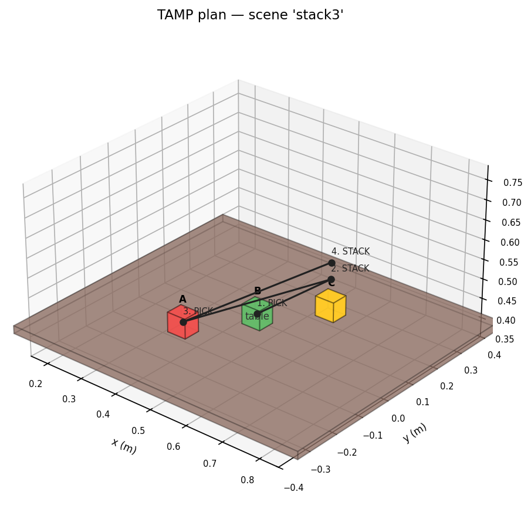
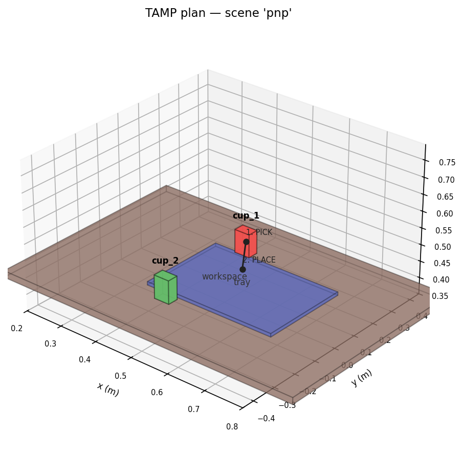
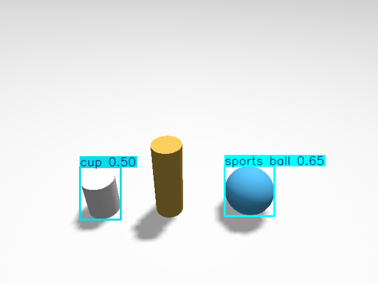
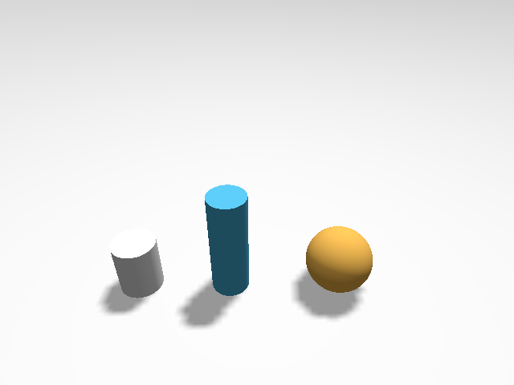

# Panda-TAMP — Closed-Loop Task & Motion Planning

**PDDL symbolic planning, bridged to real geometry, executed on a simulated
Franka Panda — with a planner that knows when it's wrong and replans.**

[](https://github.com/Manas-arumalla/panda-tamp/actions/workflows/ci.yml)
[](LICENSE)


I built this project to answer a question that most robot-planning demos dodge:
**what happens when the symbolic plan meets geometry that disagrees with it?**
Classical task planners happily emit `pick(cup); place(cup, tray)` with no idea
whether the cup is reachable, graspable, or whether the tray is 2.5 metres away.
Most demos hide that gap. This project makes the gap the whole point: the
planner and the geometry engine argue with each other in a closed loop until
they agree on a plan that is *both* logically correct and physically executable —
or until the system honestly reports that no such plan exists.



## The core idea: bridge predicates

PDDL plans purely symbolically (`pick / place / stack / unstack`). Geometry —
kinematics, grasps, collisions — lives in a separate engine (pykin FK + a
damped-least-squares IK I wrote myself, plus trimesh/FCL collision checking).
The two layers meet through four **geometric bridge predicates**:

`reachable(o)` · `graspable(o)` · `placeable(o, s)` · `stackable(o, o')`

The symbolic planner treats them as ordinary facts, but it never gets to decide
them — the geometric layer does. The loop:

1. **Seed optimistically.** Every bridge predicate starts `true`.
2. **Plan symbolically.** Fast Downward produces a candidate action sequence.
3. **Refine geometrically.** For each action: sample grasps, solve IK, sweep the
   gripper along the actual joint-space path, and check the arm links against
   the scene — not just the endpoint poses.
4. **On failure, falsify and loop.** The offending predicate is set `false` in
   the PDDL initial state and the planner runs again — now *knowing* that fact.
5. **Execution failures feed the same loop.** A grasp that slips or a placement
   that misses at runtime falsifies the same predicates and triggers a replan
   from the *observed* world state, not the assumed one.

The part I like most: the symbolic planner needs no geometric knowledge and the
geometric engine needs no search. Each does the thing it is good at, and the
falsification protocol is the entire interface between them.

<p align="center">
  
  &nbsp;
  
  <br>
  <em>Refined plans rendered straight from the solver (<code>tamp-offline --viz</code>):
  numbered end-effector waypoints over the perceived scene — every pose has passed
  IK, grasp sampling, and swept-path collision checking.</em>
</p>

### Honesty is a design constraint

A recurring failure mode of planning demos is quietly reporting success. I built
the opposite bias into every layer:

- The replanning benchmark asserts the property that matters (the block can only
  ever land on the *reachable* tray) instead of a scripted replan count — and it
  includes a counterfactual test proving the solver **reports failure** when no
  feasible surface remains, rather than emitting a plan onto one it can't reach.
- The Gazebo executor verifies **arrival by TF** (a plan is not an execution),
  gates every grasp on **measured finger closure** (a weld with open fingers is
  not a grasp), and runs a **drop detector** against simulator ground truth.
- The reliability harness (`scripts/reliability_pnp.sh`) scores a run as a pass
  only if the plan completed **and** Gazebo's ground-truth poses show every
  object physically on the target surface. Log-parsing alone doesn't count.

## What's inside

| Layer | What I built |
|---|---|
| **Symbolic** | A tabletop PDDL domain (canonical `.pddl` + a runtime `unified-planning` model kept in lockstep), a problem generator that derives `on/stacked-on/clear` from perceived poses via support heuristics, and a Fast Downward wrapper. |
| **Geometric** | Grasp sampling (top/side approaches), my own DLS IK with joint-limit clamping, random restarts, and a retry ladder for near-workspace-envelope targets; swept-path gripper collision and a per-link arm check; a shadow scene that simulates plan effects forward so later actions refine against the world the earlier actions will have created. |
| **The loop** | `TampSolver`: plan ⇄ refine ⇄ falsify ⇄ replan, with execution-time falsification (`pre_falsified`) closing the loop across plan → execute → observe → replan. |
| **Execution** | ROS 2 Jazzy + MoveIt 2 (MoveItPy/OMPL): action-interface trajectory execution with TF-verified arrival, a populated planning scene (surfaces, perceived objects, attached payloads), allowed-collision handling for grasps, and physics-based grasping in Gazebo Harmonic (DetachableJoint + finger-closure gating + contact-band verification). |
| **Perception** | YOLOv8 (COCO) on a simulated RGB-D camera with depth back-projection to metric object poses (~4 cm), publishing the same `/world_state` the mock path uses — the planner cannot tell them apart. |
| **Language** | A neuro-symbolic goal grounder: an LLM (Anthropic API / NVIDIA NIM / local Ollama) *or* a deterministic grammar proposes a **goal, never actions**; a validating DSL grounds it against perceived objects and the planner verifies feasibility. Fails closed on questions, negations, and hallucinated ids. Plus an MCP server exposing the whole planning stack as tools. |

<p align="center">
  
  &nbsp;
  
  <br>
  <em>The perception front-end: YOLOv8 detections on the simulated overhead camera,
  back-projected through depth into metric object poses.</em>
</p>

## Quickstart

The core is deliberately **ROS-free** — the full plan⇄refine⇄replan loop runs in
plain Python in seconds:

```bash
python3 -m virtualenv -p python3.12 .venv && . .venv/bin/activate
pip install -e ".[dev]"

tamp-offline --scene stack3     # symbolic + geometric plan for a 3-block stack
tamp-offline --scene replan     # watch the loop veto an unreachable tray
tamp-command "put the cups on the tray" --scene pnp   # language -> goal -> plan
python -m pytest tests/unit -q  # 70+ tests, no ROS required
```

Example output (`replan` scene — the goal offers two trays, one physically
unreachable):

```
=== TAMP [replan] ===
success=True  replans=0  reason=ok
  1. PICK(block, ...)                -> EEF [0.45  0.    0.435]
  2. PLACE(block, s=tray_near, ...)  -> EEF [0.55  0.2   0.453]
[replan] counterfactual (execution later falsifies tray_near too):
[replan]   success=False ... falsified=[('placeable','block','tray_near'), ('placeable','block','tray_far')]
[replan]   -> honest failure: no feasible tray remains.
```

### Full stack (ROS 2 Jazzy + MoveIt 2 + Gazebo Harmonic)

```bash
cd ros2_ws && colcon build --symlink-install && cd ..
bash scripts/run_ros_full.sh stack3      # plan + MoveIt execution
bash scripts/run_ros_full.sh replan      # closed-loop recovery over ROS topics
bash run.sh pnp                          # Gazebo physics pick-and-place (GUI)
bash scripts/reliability_pnp.sh 6        # ground-truth-verified reliability batch
```

The ROS layer runs two Python interpreters (the planner node needs the pinned
geometry stack; MoveItPy needs the system ROS python) — `scripts/ros_env.sh` and
the launch files handle the split. Setup details and the non-obvious MoveItPy /
Gazebo integration notes are in [docs/RUNNING.md](docs/RUNNING.md) and
[docs/ros_integration.md](docs/ros_integration.md).

## Language-grounded goals & the MCP server

The part I find most fun: you can drive the planner conversationally, and it
still can't be talked into doing something infeasible.

```
$ tamp-command --scene pnp "put all the cups on the tray"
  goal [rule]: {'type': 'sort_by_class', 'assignment': {'cup_1': 'tray', 'cup_2': 'tray'}}
  ✓ plan (4 steps, 0 replan):
     1. PICK cup_1
     2. PLACE cup_1
     3. PICK cup_2
     4. PLACE cup_2

$ tamp-command --scene pnp "do not put cup_1 on the tray"
  ✗ refused: the command is a prohibition, not a goal
```

The grounder chain is LLM-optional: Anthropic API → OpenAI-compatible (NVIDIA
NIM) → local Ollama → a deterministic grammar that always works offline. Every
backend's output — LLM or not — passes through the same validating DSL and the
same planner. The model proposes; the planner verifies. There is also an [MCP
server](docs/nl_grounding.md) exposing `get_world_state` / `plan_goal` /
`plan_command` as tools, so any MCP-capable client or agent can read the robot's
world and submit goals under exactly the same verification contract.

Details: [docs/nl_grounding.md](docs/nl_grounding.md).

## Repository layout

```
tamp/                 ROS-free core
├── pddl/             domain model + problem generator (bridge-predicate seeding)
├── planning/         Fast Downward wrapper
├── geometry/         robot model (DLS IK), grasp sampling, collision, refiner
├── reasoning/        pose -> symbolic facts (on / stacked-on / clear)
├── execution/        execution-failure -> falsified-predicate mapping
├── nl/               goal DSL, grammar + LLM grounders
└── mcp_server.py     the planning stack as MCP tools
pddl/domains/         canonical tabletop.pddl
benchmarks/           scene fixtures (stack3, replan, pnp) — also test fixtures
goals/                example goal specs (YAML)
ros2_ws/src/          ROS 2 overlay: planner node, MoveIt executor, grasp manager,
                      YOLOv8 + mock perception, launches, worlds, custom msgs
scripts/              runners: offline demo, full ROS bringup, reliability harness
tests/                unit + integration (the core runs anywhere Python runs)
docs/                 architecture, running guide, ROS notes, language layer
```

## Testing

```bash
python -m pytest tests/unit tests/integration -q
```

70+ tests cover the domain encoding, the reasoner, the refiner (including
swept-path and per-link collision regressions), the closed loop (recovery *and*
honest failure), the NL grammar's safety refusals, DSL validation, and the MCP
tool surface. CI runs the ROS-free suite on every push — deliberately only that:
I don't fake Gazebo coverage in a container that can't run it; the
physics-dependent layer is exercised by the ground-truth reliability harness on
a real machine instead.

## Engineering notes & honest limitations

Things I learned the hard way, and the edges I have not sanded off:

- **Simulated grasping is its own research problem.** The gripper uses Gazebo's
  DetachableJoint with finger-closure gating and contact-band verification —
  a documented compromise, not force-closure physics. Under Gazebo Harmonic's
  bullet-featherstone backend the fixed-joint constraint is *violable* (the
  upstream fix lands in a later Gazebo generation), which bounds multi-object
  pick-and-place reliability; the reliability harness exists precisely to
  measure that honestly rather than cherry-pick green runs.
- **Physics backends disagree.** DART silently drops URDF mimic joints; bullet
  enforces articulated dynamics faithfully enough to expose bad inertials and
  contact-margin effects that DART masked. The gripper stack (independent
  finger joints, effort limits, collision geometry, joint limits) is tuned
  against measurements, and the measurement scripts ship in `scripts/`.
- **The refiner's arm model is deliberately coarse** — a swept gripper proxy
  plus per-link spheres. It catches gross pass-throughs cheaply; MoveIt's
  full-mesh planning scene remains authoritative at execution time.
- **Simulation only.** No physical robot yet: the execution layer speaks
  standard MoveIt 2 / ros2_control interfaces, so a real Panda is the natural
  next step, but I make no hardware claims until it runs on one.

## Roadmap

- Force-aware grasping (effort-interface gripper control) to retire the
  detachable-joint compromise entirely
- The upstream fixed-constraint enforcement once it ships in binaries
  (or a local backport) for higher multi-object reliability
- Real-hardware bring-up on a physical Panda
- Richer domains: obstructions, regrasping, multi-step manipulation puzzles

## License

MIT — see [LICENSE](LICENSE).
